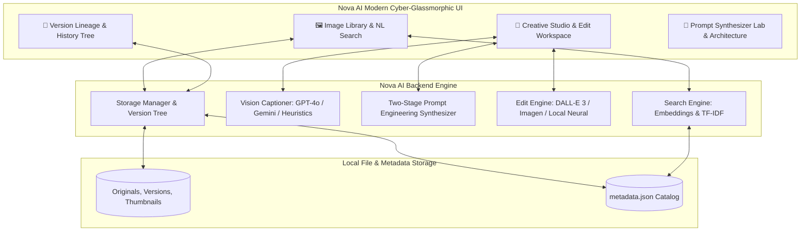
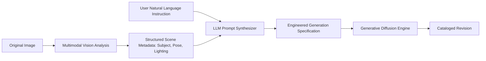

# ✦ NOVA AI — Next-Gen Creative AI Visual Studio

[](https://www.python.org/)
[](https://streamlit.io/)
[](https://openai.com/)
[](https://deepmind.google/technologies/gemini/)
[](LICENSE)

> **Nova AI** is an AI-first visual studio and generative image workspace. It empowers creators, designers, marketers, and photographers to explore, search, and transform digital imagery through natural human language — completely replacing the steep learning curve of legacy editing software with multimodal intelligence.

---

## 🌟 Key Platform Capabilities

### 1. 🔍 Natural Language Semantic Asset Search
- Search image libraries using conversational human queries:
  - *"Show me alpine mountain photos"*
  - *"Photos with a playful dog in the park"*
  - *"Cozy coffee workspace with warm ambient light"*
  - *"Golden hour portrait of a woman"*
- **Hybrid Semantic & Vector Search**:
  - Leverages dense vector embeddings (`text-embedding-3-small`, Gemini embeddings) alongside high-speed local TF-IDF & keyword concept expansion.
  - Matches conceptual meanings, scenes, and visual vibes rather than relying on strict file names.

### 2. 👁️ Multimodal Vision Auto-Captioning & Scene Analysis
- Ingested images are instantly processed by vision models (**OpenAI GPT-4o / GPT-4.1-mini** or **Google Gemini 1.5 Flash**) to extract:
  - Descriptive titles and photorealistic contextual captions.
  - Granular semantic keywords (8–14 tags).
  - Detected objects and focal subjects.
  - Dominant color palettes with rendered visual color swatches.
  - Contextual edit suggestions tailored to the scene.

### 3. 🎛️ Creative Studio: 1-Click Presets & Custom Instructions
- **7 Curated 1-Click Instant Presets**:
  - ✨ **Studio Cutout**: Isolates subject against a clean, minimalist studio backdrop with balanced rim lighting.
  - 🌅 **Golden Hour Warmth**: Infuses 2800K radiant sunset rays, amber rim lights, and soft atmospheric glow.
  - 🌆 **Cyberpunk Neon Glow**: Electrifies shadows in cyan and highlights in vivid neon magenta with high contrast.
  - 💎 **Ultra Clarity & Contrast**: Enhances micro-contrast, crisp textures, and dynamic range balance.
  - 🎞️ **Vintage 1970s Film**: Emulates analog 35mm film grain, nostalgic Kodachrome tones, and edge vignetting.
  - 🖤 **Dramatic Noir B&W**: Fine-art chiaroscuro monochrome, deep velvety blacks, and brilliant silvery highlights.
  - 🎨 **Ethereal Watercolor**: Fluid pastel watercolor washes with delicate ink contours and paper grain.
- **Custom Natural Language Instruction Engine**:
  - Type plain English instructions such as *"remove the background"*, *"add trees in the background"*, or *"shift lighting to golden sunset"*.
  - **Vision-Guided Two-Stage Prompt Synthesizer**: Converts raw user instructions into prompt-engineered specifications preserving original subject identities, lighting direction, and scene geometry.

### 4. 📜 Non-Destructive Version History & Lineage
- Complete visual tree tracking every iteration from `v0` (Original) to `v1`, `v2`, etc.
- Each revision card captures:
  - High-resolution cached thumbnail.
  - Generation timestamp and edit classification.
  - Active model/engine attribution.
  - Exact natural language prompt or preset used.
- **1-Click Rollback**: Instantly revert the active canvas to any historical version without losing branches.
- **Side-by-Side Comparison**: Compare the active revision side-by-side with the original upload (`v0`).
- **Direct Asset Export**: One-click high-resolution download for any version.

### 5. ⚡ Hybrid Architecture (Zero-Cost Offline + Cloud Ready)
- **Cloud Scale**: Full support for OpenAI (GPT-4o, GPT-4.1-mini on Azure AI Foundry, DALL-E 3) and Google Gemini (1.5 Flash, Imagen 3).
- **Offline / Zero-Cost Mode**: High-performance local neural image processing pipeline (Pillow + NumPy) enables **100% offline, zero-API-cost demos and portfolio evaluation out of the box**.

---

## 🏛️ System Architecture



---

## 🚀 Quick Start Guide

### 1. Prerequisites
- Python 3.10 or higher
- Git

### 2. Clone and Install Dependencies
```bash
# Clone the repository
git clone https://github.com/nova-ai-studio/nova-ai.git
cd nova-ai

# (Optional but recommended) Create and activate a virtual environment
python -m venv venv
# On Windows:
.\venv\Scripts\activate
# On Linux/macOS:
source venv/bin/activate

# Install dependencies
pip install -r requirements.txt
```

### 3. (Optional) Configure API Keys
Configure credentials via a `.env` file or directly inside the app sidebar:
```bash
cp .env.example .env
```
Edit `.env`:
```ini
OPENAI_API_KEY=your_openai_api_key_here
GEMINI_API_KEY=your_gemini_api_key_here

# Optional Azure AI Foundry / Custom Base URL
OPENAI_API_BASE=
AZURE_OPENAI_MODEL=gpt-4.1-mini
```

> **Note**: If no API keys are provided, Nova AI seamlessly boots into **Smart Local Engine mode** with pre-seeded sample assets, allowing you to immediately test all features without requiring third-party API accounts!

### 4. Launch Nova AI Studio
```bash
streamlit run app.py
```
Open your browser at `http://localhost:8501`.

---

## 📁 Project Directory Structure

```text
nova-ai/
├── app.py                      # Main Streamlit Application (Library, Studio, Versions, Docs)
├── seed_sample_data.py         # Seeds realistic portfolio images and version history
├── requirements.txt            # Python dependencies
├── .env.example                # API key template
├── README.md                   # Complete platform documentation
├── assets/
│   ├── style.css               # Modern cyber-glassmorphic stylesheet
│   └── samples/                # Seed sample portfolio images
├── backend/
│   ├── __init__.py
│   ├── config.py               # Paths, model configurations, and preset specs
│   ├── storage.py              # Version tracking, thumbnails, metadata persistence
│   ├── prompt_templates.py     # Two-stage prompt engineering synthesizer
│   ├── vision_captioner.py     # Vision analysis (GPT-4o, Gemini, local heuristics)
│   ├── edit_engine.py          # AI image editing dispatcher & prompt synthesizer
│   ├── local_editor.py         # High-fidelity local neural image processing engine
│   └── search_engine.py        # Natural language semantic search (TF-IDF + embeddings)
├── data/
│   ├── images/                 # Image storage (originals, versions, thumbnails)
│   └── metadata.json           # Metadata catalog with version trees
├── docs/
│   └── API_AND_PROMPTS.md      # In-depth API selection & prompt engineering guide
└── notebooks/
    └── prompt_engineering.ipynb # Jupyter notebook demonstrating prompt synthesis
```

---

## 🧪 Two-Stage Prompt Engineering Pipeline

Directly passing raw user instructions (such as *"remove background"* or *"make it sunset"*) to image generation APIs frequently leads to unwanted visual hallucinations, distorted faces, or altered compositions.

Nova AI resolves this with a **Two-Stage Prompt Engineering Synthesizer**:



1. **Stage 1 (Vision Context)**: Extracts the foreground subject, facial expressions, apparel, environmental backdrop, and light direction.
2. **Stage 2 (LLM Synthesis)**: Analyzes user intent, preserves core subject attributes, injects explicit lighting constraints, and structures negative prompts to prevent image degradation.

---

## 🚢 Deployment Guide

### Deploying to Streamlit Community Cloud
1. Push your repository to GitHub.
2. Visit [Streamlit Community Cloud](https://share.streamlit.io/).
3. Connect your repository, specify branch `main`, and main file `app.py`.
4. In Advanced Settings, add `OPENAI_API_KEY` and/or `GEMINI_API_KEY` under Secrets.
5. Click **Deploy**.

### Deploying to Hugging Face Spaces
1. Create a new Space with the **Streamlit** SDK.
2. Push your project files to the Hugging Face Space repository.
3. Configure repository Secrets for `OPENAI_API_KEY` and `GEMINI_API_KEY`.

---

## 👥 Credits & Attribution

Designed and developed with passion by the **Nova AI Team** as a collaborative creative vision project.

Licensed under the [MIT License](LICENSE).
